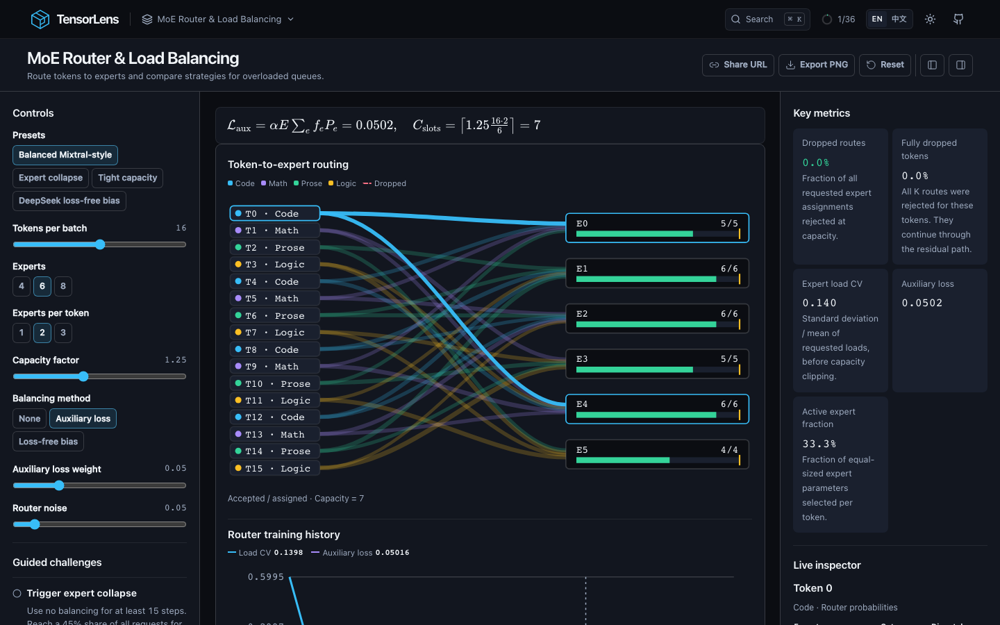

# TensorLens

[简体中文](README.zh-CN.md) · [Contributor guide](CONTRIBUTING.md)

[](LICENSE)
[](.github/workflows/ci.yml)
[](#the-labs)

TensorLens is a bilingual, browser-based workbench for exploring how language models and generative models compute. Change a token, a weight, or a solver step and inspect the numbers that produced the picture. All twelve labs run locally against small, reproducible TypeScript models. The static site includes its equations, fonts, and simulation code.



## Try an experiment

Open **Multi-Head Attention Debugger**, choose the bidirectional mask and inspect the first query's weight on the next token. Switch to the causal mask while keeping that cell selected. Its weight becomes zero, and the remaining allowed weights sum to one. **Share URL** preserves the configuration, step and selection so someone else can inspect the same result. **Export PNG** saves the visualization stage.

Use **⌘K** or **Ctrl+K** to search labs, concepts and presets. The arrow keys step through a calculation, **Space** toggles playback and **R** restores the active preset. Each lab has three challenges evaluated against its current computation. Language, theme and completed challenges are saved in this browser.

## The labs

The lab names link to their numerical engines and invariant tests.

| # | Lab | An experiment to try |
| --- | --- | --- |
| 01 | [BPE tokenizer and subwords](src/engine/labs/bpe-tokenizer/) | Train on your own text, replay byte-pair merges and inspect the tree of a multi-byte token. |
| 02 | [Embeddings and RoPE](src/engine/labs/embeddings-rope/) | Shift a query and key together. Compare their dot product across position interpolation and NTK scaling. |
| 03 | [Multi-head attention](src/engine/labs/attention-debugger/) | Follow one matrix cell from a query–key dot product to its weighted value contribution. |
| 04 | [Normalization and residuals](src/engine/labs/norm-residual/) | Move normalization across the skip connection and trace a scalar output's gradient through 32 layers. |
| 05 | [KV cache and inference](src/engine/labs/kv-cache-profiler/) | Compare cached and uncached decoding, then change head sharing or KV precision to fit a memory budget. |
| 06 | [FlashAttention](src/engine/labs/flash-attention/) | Follow a tile through online softmax. Count reads and writes and compare its output with dense attention. |
| 07 | [MoE routing](src/engine/labs/moe-routing/) | Overflow an expert, inspect the dropped routes and compare auxiliary-loss and bias-based balancing. |
| 08 | [Quantization and precision](src/engine/labs/quantization/) | Flip an exponent bit, then measure the reconstruction error of INT4 and NF4 on a tensor with outliers. |
| 09 | [Decoding and sampling](src/engine/labs/decoding-sampling/) | Trace probability mass through top-k, top-p and min-p. Compare a greedy branch with beam search. |
| 10 | [LoRA and low-rank SVD](src/engine/labs/lora-svd/) | Train two low-rank factors and compare the reconstruction error with the best attainable SVD bound. |
| 11 | [Autograd and optimizers](src/engine/labs/backprop-optimizers/) | Inspect the chain rule edge by edge, check a gradient by finite differences and race five optimizers. |
| 12 | [Diffusion and flow matching](src/engine/labs/diffusion-flow/) | Start DDPM, DDIM and flow matching from the same 120 particles and measure path length and class purity. |

The residual lab reports gradients for the **first output channel**. Its separate Pre-LayerNorm invariant uses an all-ones probe and the block's response to a uniform shift. RMSNorm gradient ratios are measured for the selected input and weights. The KV and LoRA memory charts use explicit storage assumptions. Inference timing uses an idealized hardware roofline, so the selected capacity and peak rates govern the estimate. [Residual tests](src/engine/labs/norm-residual/__tests__/network.test.ts) · [Inference model](src/engine/labs/kv-cache-profiler/engine.ts) · [Training memory model](src/engine/labs/lora-svd/memory.ts)

## Run locally

Use Node.js 24 and npm to match CI. From a checkout of the repository, install the locked dependencies and start Vite.

```sh
npm ci
npm run dev
```

Open the local address printed by Vite. Append `/#/labs/attention-debugger?preset=causal&step=3` to the local origin to open the masking step directly.

To run the full verification gate, first install Chromium for Playwright. On Linux CI, use `npx playwright install --with-deps chromium` to include system packages.

```sh
npx playwright install chromium
npm run typecheck && npm run lint && npm run test && npm run build && npm run test:e2e
```

The build checks the landing JavaScript budget (under 200 kB gzip) and verifies that every lab has its own lazy entry. Vitest runs the engines in Node and component tests in jsdom. Playwright serves the production build on port 4173 and uses Chromium at 1440 × 900 and 390 × 844. For a manual inspection of that build, run `npm run preview` after the tests finish.

## Architecture

| Location | Responsibility |
| --- | --- |
| [src/engine/math](src/engine/math/) | Matrices, seeded randomness, scalar autodiff, SVD, floating-point codecs and numerical helpers. |
| [src/engine/labs](src/engine/labs/) | Pure numerical models, presets and invariant tests, runnable independently of the UI. |
| [src/labs](src/labs/) | Lazy-loaded workbenches. The registry provides catalog metadata and route components. The preset catalog supplies searchable preset commands. |
| [src/components](src/components/) | Shared workbench, playback, Canvas/SVG charts, KaTeX formulas, URL state and PNG export. |
| [src/i18n](src/i18n/) · [src/store](src/store/) | Typed English and Simplified Chinese dictionaries, local preferences and challenge progress. |
| [e2e](e2e/) | Browser tests for numerical interactions, navigation, state restoration and downloads. |

## Deploy to GitHub Pages

In a GitHub repository containing this checkout, select **Settings → Pages → Build and deployment → Source → GitHub Actions**. Push to `main` or run **Deploy to GitHub Pages** from the Actions tab. The workflow builds `dist/`, uploads it as a Pages artifact and lists the published address in the `github-pages` environment. During the build, it sets `VITE_REPOSITORY_URL` from the actual repository. Vite's relative asset base and hash routing support deployment below a repository subdirectory. [Deployment workflow](.github/workflows/deploy.yml)

The project is released under the MIT license. [License](LICENSE)
