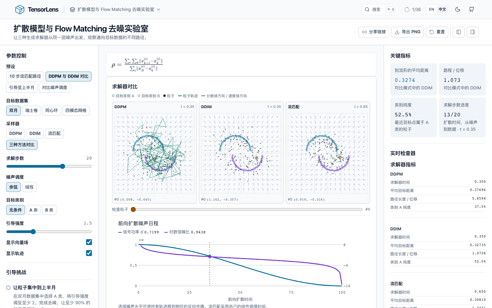

# TensorLens

[English](README.md) · [贡献指南](CONTRIBUTING.md)

[](LICENSE)
[](.github/workflows/ci.yml)
[](#实验室目录)

TensorLens 是一个可在浏览器中运行的中英双语实验台，用来探索语言模型和生成模型的计算过程。改变一个词元、一个权重或一个求解步数，就能查看图像背后的数值。12 个实验室都在本地运行小规模、可复现的 TypeScript 模型。公式、字体和模拟代码随静态站点一起分发。



## 做一次实验

打开「自注意力与多头注意力调试器」，选择双向掩码，查看第一个查询分配给下一个词元的注意力权重。保持选中该单元格，切换到因果掩码。它的权重变为零，其余允许位置的权重之和为一。使用分享功能可把参数、当前步骤和选区写入网址，让别人复查同一个结果。导出 PNG 可保存当前可视化画面。

按 **⌘K** 或 **Ctrl+K** 可搜索实验室、概念和预设。左右方向键用于单步查看，**空格**用于播放或暂停，**R** 用于恢复当前预设。每个实验室都有三项根据实时计算结果判定的挑战。语言、主题及已完成的挑战保存在当前浏览器内。

## 实验室目录

点击实验室名称可阅读对应的计算引擎与数学不变量测试。

| 编号 | 实验室 | 可以验证的问题 |
| --- | --- | --- |
| 01 | [分词器与 BPE 合并](src/engine/labs/bpe-tokenizer/) | 用自己的文本训练，逐次回放字节对合并，拆解多字节词元的合并树。 |
| 02 | [词嵌入与 RoPE](src/engine/labs/embeddings-rope/) | 同时平移查询与键的位置，在位置插值和 NTK 缩放下对比点积。 |
| 03 | [多头注意力](src/engine/labs/attention-debugger/) | 选一个矩阵单元格，追踪查询与键的点积，以及它对输出向量的加权贡献。 |
| 04 | [归一化与残差流](src/engine/labs/norm-residual/) | 改变归一化和跳跃连接的相对位置，沿 32 层网络追踪一个输出通道的梯度。 |
| 05 | [KV 缓存与推理显存](src/engine/labs/kv-cache-profiler/) | 对比有无缓存的解码，调整键值头共享方式或缓存精度，让配置符合显存预算。 |
| 06 | [FlashAttention 分块](src/engine/labs/flash-attention/) | 跟随一个数据块更新在线 softmax，统计读写量，并与普通注意力的输出对照。 |
| 07 | [MoE 路由与负载均衡](src/engine/labs/moe-routing/) | 让一个专家过载，检查被丢弃的路由，对比辅助损失与偏置均衡策略。 |
| 08 | [量化与精度损失](src/engine/labs/quantization/) | 翻转一个指数位，再比较 INT4 与 NF4 对含离群值张量的重构误差。 |
| 09 | [文本解码与采样](src/engine/labs/decoding-sampling/) | 观察 top-k、top-p、min-p 逐步筛选概率质量，并对比贪心解码与束搜索。 |
| 10 | [LoRA 与低秩 SVD](src/engine/labs/lora-svd/) | 训练两个低秩因子，将重构误差与 SVD 给出的最优下界比较。 |
| 11 | [反向传播与优化器](src/engine/labs/backprop-optimizers/) | 逐边检查链式法则，用有限差分复核梯度，在同一损失曲面比较五种优化器。 |
| 12 | [扩散与流匹配](src/engine/labs/diffusion-flow/) | 让 DDPM、DDIM 和流匹配从相同的 120 个粒子出发，比较轨迹长度和类别纯度。 |

残差实验显示的是**第一个输出通道**的梯度。针对前置 LayerNorm 的独立不变量测试采用全一方向的探针，利用了残差块对统一平移的响应。RMSNorm 的梯度比值由当前输入和权重测得。KV 缓存和 LoRA 的内存图采用明确的存储假设，推理耗时则由理想屋顶线模型估算，取决于所选硬件的容量和峰值参数。[残差测试](src/engine/labs/norm-residual/__tests__/network.test.ts) · [推理模型](src/engine/labs/kv-cache-profiler/engine.ts) · [训练内存模型](src/engine/labs/lora-svd/memory.ts)

## 本地运行

使用 Node.js 24 和 npm 可与 CI 环境保持一致。在仓库根目录安装锁定版本的依赖并启动 Vite。

```sh
npm ci
npm run dev
```

打开 Vite 输出的本地地址。在站点地址后加上 `/#/labs/attention-debugger?preset=causal&step=3`，可以直接进入因果掩码的计算步骤。

首次运行完整验证前，请安装 Playwright 使用的 Chromium。在 Linux CI 中可用 `npx playwright install --with-deps chromium` 一并安装所需系统包。

```sh
npx playwright install chromium
npm run typecheck && npm run lint && npm run test && npm run build && npm run test:e2e
```

构建会校验首页 JavaScript 压缩后小于 200 kB，并检查每个实验室是否有独立的懒加载入口。Vitest 在 Node 中测试引擎，在 jsdom 中测试组件。Playwright 使用端口 4173 启动生产构建的预览，并在 Chromium 的 1440 × 900 和 390 × 844 两种视口下运行。测试结束后可使用 `npm run preview` 手动检查同一份构建。

## 代码结构

| 位置 | 职责 |
| --- | --- |
| [src/engine/math](src/engine/math/) | 矩阵、带种子的随机数、标量自动微分、SVD、浮点编解码及数值工具。 |
| [src/engine/labs](src/engine/labs/) | 可脱离界面独立运行的数值模型、预设和不变量测试。 |
| [src/labs](src/labs/) | 按需加载的实验工作台。注册表提供目录信息与路由组件，预设目录为命令面板提供搜索项。 |
| [src/components](src/components/) | 共享工作台、播放控件、Canvas/SVG 图表、KaTeX 公式、网址状态与 PNG 导出。 |
| [src/i18n](src/i18n/) · [src/store](src/store/) | 有类型约束的中英文词典、本地偏好和挑战进度。 |
| [e2e](e2e/) | 检查数值交互、页面导航、状态恢复及下载的浏览器测试。 |

## 部署到 GitHub Pages

在托管此项目的 GitHub 仓库中，打开 **Settings → Pages → Build and deployment → Source**，选择 **GitHub Actions**。推送到 `main`，或在 Actions 面板手动运行 **Deploy to GitHub Pages**。工作流将生成的 `dist/` 上传为 Pages 构件，部署地址显示在 `github-pages` 环境中。构建时的 `VITE_REPOSITORY_URL` 取自当前仓库。Vite 使用相对资源路径，配合哈希路由，可部署在仓库名对应的子目录下。[部署工作流](.github/workflows/deploy.yml)

本项目采用 MIT 许可证。[许可证全文](LICENSE)
